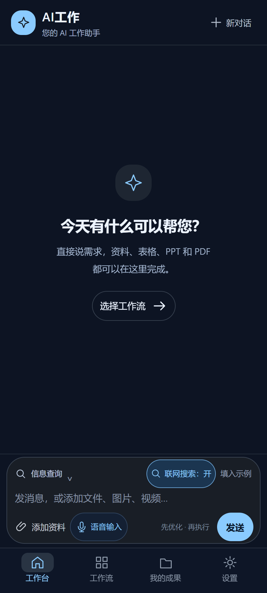

# AI工作 2.3.4

面向没有提示词经验的办公工作者的 Android AI 助手。用户填写自己的 DeepSeek API Key，用普通语言发起任务，先由 AI 优化需求，再执行并生成工作成果。



## 安装

下载安装包：[AI-work-v2.3.4.apk](releases/AI-work-v2.3.4.apk)。Android 8.0（API 26）及以上。安装后在设置填写自己的 API 地址、模型和 Key。不要把真实 Key 提交到仓库。

## 功能

- 普通聊天式工作台、8个办公工作流、Prompt Enhancer 优化环节。
- 信息查询及联网搜索开关；检索依赖配置的 API 服务是否支持相应接口。
- Excel（XLSX）、PowerPoint（PPTX）、PDF、文字成果导出。
- 文件、图片、视频、文字资料输入；具体识别效果受材料和模型能力限制。
- 系统语音转文字入口、草稿追加、手动确认后发送。
- 冷色深色、圆润紧凑 UI、大字体模式和本机成果历史。
- Keystore API Key 信封加密、四层 UI 资源加密、R8 / JavaScript 混淆。

**vivo专有语音SDK未接入。** 现有实现仍是 Android 系统识别及键盘回退；不能保证目标vivo机型可用。四层保护指资源加密加载，不是四种商业DEX/虚拟机壳。详见[保护与验证边界](docs/protection-and-validation.md)。

## 从源码构建（Windows）

需要 JDK 17、Node.js/npm、Android SDK Platform 34、Build Tools 34.0.0。项目使用命令行 aapt/javac/R8，不是 Gradle 项目。

在仓库根目录执行：

```powershell
npm --prefix app ci
$env:ANDROID_HOME='E:\AndroidSdk' # 改为你的 SDK 路径
& .\app\build.ps1 -Sdk $env:ANDROID_HOME -BuildDir "$PWD\build" -OutputApk "$PWD\build\AI-work-v2.3.4.apk"
```

构建会先编译界面、压缩发布副本、四层加密资源，再执行R8和APK签名。默认在本机生成 `build/local-signing.p12`，脚本中的默认口令仅为本地测试约定，不是发布级凭据。**原签名私钥未打包**；新机器生成的不同签名不能直接覆盖已安装的原签名版本。正式发布需由维护者配置自己的签名流程，并私下备份原密钥，不要提交到GitHub。

## 测试

根目录运行：

```powershell
npm --prefix app test
```

浏览器回归需已安装 Chrome。终端一：

```powershell
node app/tools/test-server.cjs app/assets
```

终端二（保持仓库根目录为工作目录）：

```powershell
node app/tests/chat-layout.test.cjs
node app/tests/ui.test.cjs
node app/tests/execution-ui.test.cjs
node app/tests/search-ui.test.cjs
node app/tests/search-button.test.cjs
node app/tests/voice-ui.test.cjs
node app/tests/roundness.test.cjs
node app/tests/visual-polish.test.cjs
node app/tests/density.test.cjs
node app/tests/compact.test.cjs
```

默认Chrome路径是 `C:/Program Files/Google/Chrome/Application/chrome.exe`，大部分测试支持 `CHROME_PATH` 指定其他位置。浏览器用固定响应，不调用真实AI，不读取你的Key。加密发布页测试需先用 `ProtectedReleaseTest.java` 从构建产物生成 `work/protected-page.html` 和 `work/bootstrap-test.html`；其余原生及Office测试见 [app/README.md](app/README.md)。

